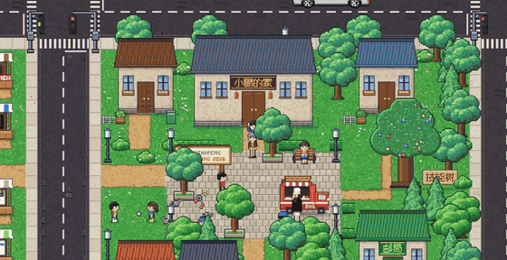
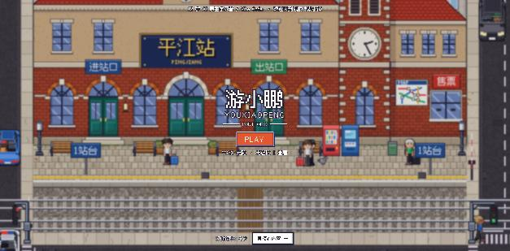
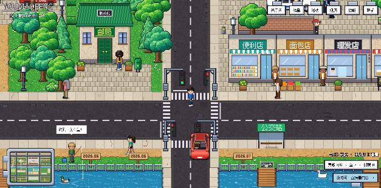
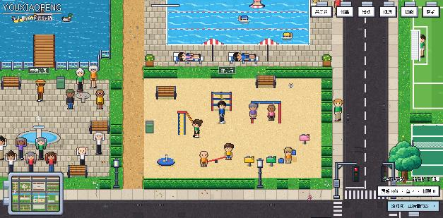
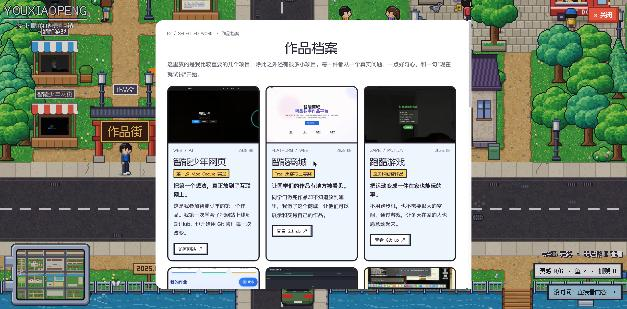

# You Xiaopeng's Pixel Town · youxiaopeng.com

**[中文](README.md) · English**


[](LICENSE)

My personal website. It is not a normal résumé page — it is a little pixel town you can walk around. You arrive by train at Pingjiang Station, stroll down a street of market stalls, cross the plaza, visit the stage, and find my bio, projects and story inside the buildings.

**Play it: <https://youxiaopeng.com>** (the site itself is in Chinese)



*From my front door, across the plaza, the road and the bridge, to the stage (13 seconds)*



## What's in the town

| Place | What you find there |
|---|---|
| Xiaopeng's home | About me |
| Works Street | 10 stalls, one project each |
| The stage | My talks at TEDx Xiamen and the BAAI Conference |
| Hackathon camp | The 4 hackathons I've joined |
| Signposts by the river | My timeline, one sign per event |
| Skill tree | Languages, tools and platforms I use |
| Post office | How to reach me |

The town also lives its own life:

- 12 kinds of vehicles that wait at red lights, turn corners and yield to pedestrians — you can see the drivers through the windows
- A high-speed train that pulls in, stops and leaves; people wait for it before crossing the tracks
- Shopkeepers who pace around, step inside, and wave when you come close
- A park with square dancing, tai chi, chess and fishing; a pitch with football and basketball, and a cheering crowd
- Thieves causing trouble downtown, and police cars driving into the plaza to catch them
- If you stand still, your character shifts pose, has a snack, stretches — and eventually lies down for a nap







## How to play

| | Desktop | Phone |
|---|---|---|
| Walk | `W` `A` `S` `D` | Drag anywhere on the screen, or tap the ground |
| Look | Walk close and press `E` | Tap a building or a label |
| Jump to a place | Buttons at the top right | "菜单" (menu) at the top right |

In a hurry? "直接看内容" on the start screen and at the bottom right switches to a plain scrolling page.

## How it's built

- **One HTML file** (`index.html`). No framework, no game engine, no scripts from other sites.
- **All pixel art is drawn by code.** People, houses, trees, cars and the station are painted pixel by pixel on a Canvas in the browser. The only image files in this repo are my photos and project screenshots.
- **Cars are built, then photographed.** Each car is first assembled from small blocks in 3D (body, cabin, wheels, seats), then rendered from above at 8 angles, so cars can turn corners diagonally.
- **Characters face 8 directions with a 6-frame walk cycle**, and their steps follow the distance actually covered.
- **Pathfinding:** townsfolk and tap-to-walk use A*; pedestrians stay off the road and use zebra crossings.
- **Font:** [Fusion Pixel](https://github.com/TakWolf/fusion-pixel-font) (SIL OFL 1.1).
- **Hosting:** Vercel, with security headers set in `vercel.json`.

I made this site together with AI (Claude Code): I say what I want and what looks wrong, the AI writes the code, I look at the result and ask for changes — over many, many rounds.

## Run it locally

```bash
git clone https://github.com/tacotacoqw/youxiaopeng-portfolio.git
cd youxiaopeng-portfolio
python3 -m http.server 8765
```

Then open <http://127.0.0.1:8765>.

## Files

```
index.html     the whole site (content + town)
images/        my photos and project screenshots
fonts/         pixel font
docs/          screenshots for this README
vercel.json    deployment config
```

## Thanks

The look and feel of the town is inspired by Peter Oravec's personal site, [peteroravec.com](https://peteroravec.com) — thank you for making something so fun. All art and code here were written from scratch; none of his assets are used.

## License

Code is under the [MIT License](LICENSE). The photos and screenshots in `images/` and `docs/`, and the personal text on the site, are not covered — please don't reuse them.

© 2026 You Xiaopeng
