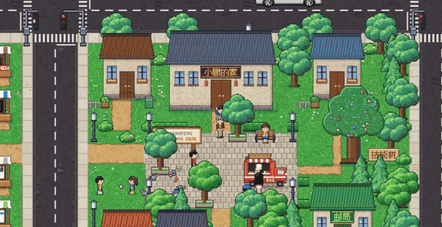
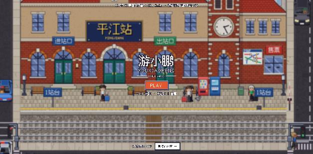
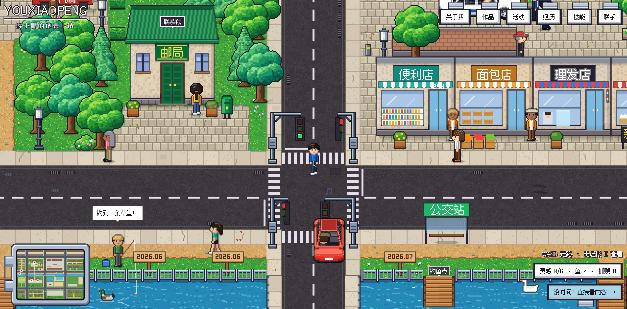
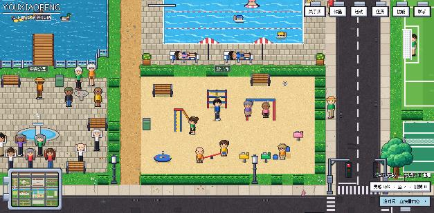
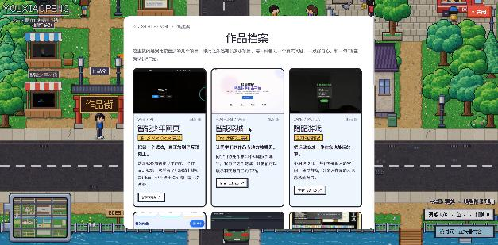

# 游小鹏的像素小镇 · youxiaopeng.com

我的个人网站。它不是一张普通的简历页，而是一座可以走来走去的像素小镇：坐高铁到平江站下车，逛作品街、去广场、看舞台，走近建筑就能看到我的介绍、作品和经历。

**在线访问：<https://youxiaopeng.com>**



*从家门口出发，穿过广场、过马路、过桥，走到演讲舞台（13 秒）*



## 小镇里有什么

| 地点 | 能看到什么 |
|---|---|
| 小鹏的家 | 关于我 |
| 作品街 | 10 个摊位，每个摊位是一个作品 |
| 演讲舞台 | TEDx 厦门、智源大会的分享 |
| 黑客松营地 | 参加过的 4 场黑客松 |
| 河边的路牌 | 成长轨迹，一块路牌一件事 |
| 技能树 | 会用的语言、工具和平台 |
| 邮局 | 联系方式 |

除了这些，小镇自己也在"过日子"：

- 马路上有 12 种车，会等红灯、转弯、让行人；车窗里看得到司机
- 高铁会进站、停靠、开走，行人会等它过去再过铁轨
- 店员会在门口走动、进店、和你打招呼
- 公园里有人跳广场舞、打太极、下棋、钓鱼，球场上有人踢球打球，观众会欢呼
- 闹市区会有小偷闹事，警车开进广场抓人
- 你站着不动，角色会换站姿、吃东西、伸懒腰，站久了会躺下睡觉







## 怎么玩

| | 电脑 | 手机 |
|---|---|---|
| 走路 | `W` `A` `S` `D` | 按住屏幕往想去的方向拖，或者点一下地面 |
| 查看 | 走近后按 `E` | 点建筑或标签 |
| 快速前往 | 右上角的按钮 | 右上角"菜单" |

没时间逛？开始页和右下角都有"直接看内容"，会变成一张普通的上下滑动页面。

## 怎么做的

- **只有一个 HTML 文件**（`index.html`），没有用任何框架和游戏引擎，也不依赖外部网站的脚本。
- **所有像素画都是代码画出来的**：人物、房子、树、车、车站，都是在浏览器里用 Canvas 一格一格画的，没有用图片素材。仓库里的图片只有我的照片和作品截图。
- **汽车是先"搭"再"拍"**：先用小方块搭出一辆立体的车（车身、驾驶舱、轮子、座椅），再从斜上方朝 8 个角度各画一张，所以转弯时能斜着过弯。
- **人物有 8 个朝向、6 帧走路动画**，迈步快慢按实际走过的距离算。
- **寻路**：镇民和点击走路用的是 A* 寻路，会绕开障碍，不走马路只走斑马线。
- **字体**：[Fusion Pixel](https://github.com/TakWolf/fusion-pixel-font)（SIL OFL 1.1）。
- **部署**：Vercel，`vercel.json` 里配了安全响应头。

这个网站是我和 AI（Claude Code）一起做的：我说想要什么、哪里不对，AI 写代码，我再看效果提修改意见，来回改了很多轮。

## 本地运行

```bash
git clone https://github.com/tacotacoqw/youxiaopeng-portfolio.git
cd youxiaopeng-portfolio
python3 -m http.server 8765
```

然后打开 <http://127.0.0.1:8765>。

## 目录

```
index.html     整个网站（内容 + 小镇）
images/        我的照片、作品截图
fonts/         像素字体
docs/          README 用的截图
vercel.json    部署配置
```

## 致谢

小镇的画风和玩法参考了 Peter Oravec 的个人网站 [peteroravec.com](https://peteroravec.com)，谢谢他做了这么好玩的东西。本站的画面和代码都是重新写的，没有使用他的素材。

© 2026 游小鹏
